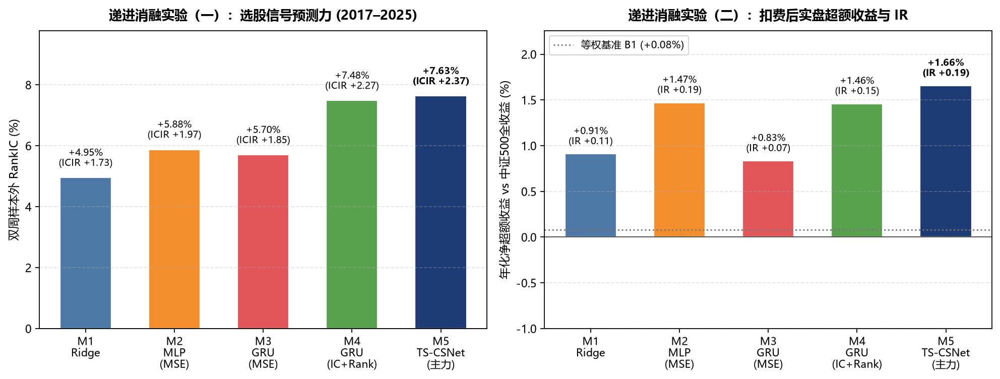
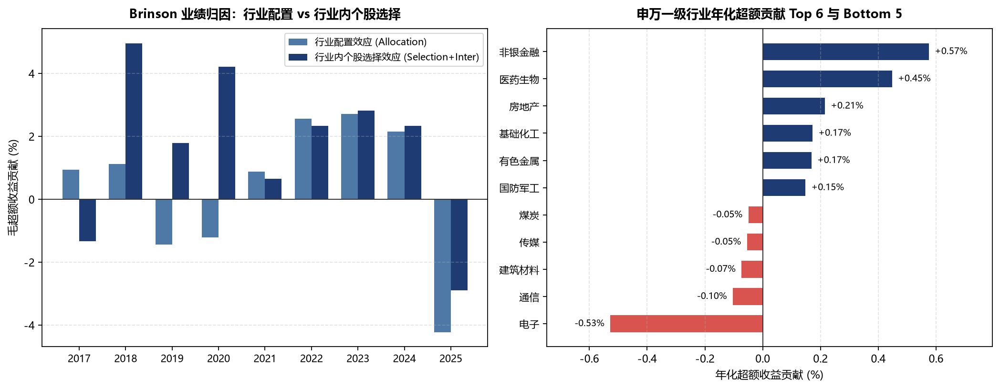
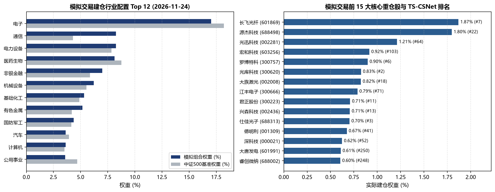

# TS-CSNet: 时序-截面双视角神经网络与无偏排序损失在中证 500 指数增强中的实证研究

[](#) [](#) [](#)

本项目面向**北京大学量化投资课程实践与中期/结项答辩**，从 0 到 1 自主构建了一套轻量级端到端深度学习选股与指数增强系统 **`TS-CSNet`（Temporal-CrossSectional Network，14,977 参数，纯 CPU 友好）**。项目基于严格 Point-in-Time（PIT）中证 500 历史周度成分股与日频行情/估值数据（`2014–2025` 历史回测，`2026-11-24` 实时模拟交易建仓），完成了 9 年样本外递进消融、深度归因/适用性分析以及 1,000 万元实盘合规模拟组合落地。

> **核心文档直达**：
> - 📄 [课程项目中期进展报告（含持仓/Brinson/风格归因、适用性分析与 2026-11-24 模拟交易清单）](docs/MIDTERM_PROGRESS_REPORT.md)
> - 🎤 [课程答辩讲解手册（含 10 分钟 PPT 框架与高频追问回答）](docs/DEFENSE_GUIDE.md)
> - 📊 [2026-11-24 实时模拟交易全量建仓清单（422 只标的，100 股/科创板 200 股合规）](outputs/paper_portfolio_live_full.csv)

---

## 1. 核心算法设计与定量迭代亮点

- **极简纯 PIT 双模态输入（6 时序通道 + 8 静态特征）**：
  - **20 日量价序列 (`X_seq: 20×6`)**：日收益率、隔夜跳空、日内振幅、收盘相对位置、对数换手率、相对 20 日均量比；
  - **8 维公告日纯 PIT 静态特征 (`X_stat: 8`)**：`EP_TTM`、`BP_MRQ`、估值反推隐含 `ROE_TTM (PB/PE)`、`60日 ROE 改善`、`对数流通市值`、`60日动量`、`60日波动率`、`20日换手率变异系数`（彻底告别重述季报漏洞）。
- **自建轻量架构 `TS-CSNet`（14,977 参数）**：
  1. `1-Layer GRU (d=32)` 编码 20 日量价走势形态；
  2. `Gated Fusion` 通过 Sigmoid 门控 $h = g \odot h^{\text{seq}} + (1 - g) \odot h^{\text{stat}}$ 动态权衡“量价 vs 基本面”，提供白盒可解释性；
  3. `2-Head Cross-Sectional Self-Attention` 以单日全市场 ~500 只股票为完整截面 Batch 进行横向强弱校准。
- **攻克“Jensen 不等式波动率陷阱”的无偏排序损失**：
  - 首轮直接迁移信息检索指数型 `ListNet (softmax(y/0.5))` 时，异方差股票收益的方差项 $\sigma^2/(2\tau^2)$ 压倒均值项 $\mu/\tau$，导致模型反向买入高波动彩票股（`RankIC -4.63%`）；
  - 修正为基于对称截面排名目标 $y^{\text{rank}}$ 的无偏复合损失：
    $$\mathcal{L}_t = -\text{PearsonIC}(\hat{s}_t, y_t^{\text{rank}}) + 0.5 \cdot \mathcal{L}_{\text{PairwiseRankNet}}(\hat{s}_t, y_t^{\text{rank}})$$
    并在单元测试中通过异方差零偏差蒙特卡洛检验，样本外 `RankIC` 跃升至 **`+7.63%`（年化 `ICIR +2.37`，胜率 `70.5%`）**。
- **防泄露与实盘规范**：
  - 年度滚动重训（3 年窗口 + 24 周早停验证）+ **精确 10 日隔离期（Purge Gap）** + 3 种子集成；
  - `T+1` 开盘涨跌停/停牌/ST 硬约束 + A 股分段真实税费 + 基准锚定 `Soft-Tilt` 指数增强（实盘模拟支持科创板 ≥ 200 股门槛与二阶段贪心余钱补手）。

---

## 2. 9 年样本外递进消融核心结果（2017–2025，Soft-Tilt 指数增强）

| 模型 | 参数量 | 双周 RankIC | 年化 RankICIR | RankIC 胜率 | 年化收益 | 年化净超额 | 信息比率 IR | 相对最大回撤 | 年化单边换手 |
| :--- | ---: | ---: | ---: | ---: | ---: | ---: | ---: | ---: | ---: |
| `B0_CSI500_TR` (中证500全收益) | 0 | — | — | — | +3.25% | 0.00% | 0.00 | 0.00% | 0.00x |
| `B1_CSI500_EW` (成分股等权) | 0 | — | — | — | +3.33% | +0.08% | -0.02 | -11.80% | 0.83x |
| `M1_Ridge` (线性岭回归) | 26 | +4.95% | +1.73 | 65.2% | +4.18% | +0.91% | +0.11 | -10.18% | 3.01x |
| `M2_MLP_MSE` (全连接+MSE) | 2,081 | +5.88% | +1.97 | 67.4% | +4.76% | +1.47% | +0.19 | -12.84% | 3.28x |
| `M3_GRU_MSE` (时序GRU+MSE) | 6,433 | +5.70% | +1.85 | 65.2% | +4.11% | +0.83% | +0.07 | -13.04% | 2.91x |
| `M4_GRU_ICRank` (GRU+无偏排序) | 6,433 | **+7.48%** | **+2.27** | **68.7%** | +4.75% | +1.46% | +0.15 | -15.28% | 2.80x |
| **`M5_TSCSNet` (主力完整模型)** | **14,977** | **+7.63%** | **+2.37** | **70.5%** | **+4.95%** | **+1.66%** | **+0.19** | **-14.62%** | **2.69x** |

- **深度归因结论**：Brinson 行业内个股选择效应贡献 **`+2.36%/年`**（2017–2024 连续 8 年为正），清零尾部约 83 只弱势股贡献约 `59%` 毛超额；CAPM `Beta = 0.838`、纯 `Alpha = +1.97%/年`；在震荡市（`+2.01%`, `IR +0.39`）、下跌熊市（`+8.08%`, `IR +1.82`）和高波动市（`+2.97%`, `IR +0.45`）表现稳健。
- **2026-11-24 实时模拟交易**：1,000 万元模拟增强基金实际建仓 `422` 只股票（市值 `994.00` 万元、仓位 `99.40%`，预估佣金滑点 `9,940` 元，现金 `5.00` 万元），自动清零排雷 `78` 只高估/亏损/过热尾部股（如华虹宏力、燕东微、芯源微等）。





---

## 3. 项目目录结构

```text
tscs-alpha/
  tscs_alpha/
    config.py        # 全局实验配置（特征、滚动窗口、超参、A股交易费用）
    dataset.py       # 只读 PIT 数据加载与无未来函数张量构建
    losses.py        # 自定义量化损失（MSE / PearsonIC / 无偏 Pairwise RankNet）
    models.py        # PyTorch 自建消融模型（MLPScorer / GRUScorer / TSCSNet）
    trainer.py       # 严格 10 日隔离期年度滚动训练器（多进程 CPU 并行 + 3 种子集成）
    backtest.py      # 真实撮合回测引擎（Soft-Tilt 指数增强 & Top-50/100 对照）
    plots.py         # 消融与可解释性高清绘图模块
  scripts/
    01_build_dataset.py                 # 构建并审计历史张量缓存
    02_run_experiments.py               # 运行 9 年滚动消融实验（支持 --eval-only）
    03_make_figures.py                  # 生成核心消融图表（图 1-4）
    04_attribution_and_applicability.py # 深度持仓/Brinson/风格归因与适用性分析（图 5-7）
    05_fetch_live_paper_data.py         # BaoStock 拉取最新中证 500 实盘快照
    06_generate_paper_portfolio.py      # 生产版 TS-CSNet 实盘打分与 1000 万合规建仓（图 8）
  tests/
    test_tscs_alpha.py                  # 离线单元测试（4/4 通过）
  docs/
    MIDTERM_PROGRESS_REPORT.md          # 课程项目中期进展报告
    DEFENSE_GUIDE.md                    # 课程答辩讲解手册
  outputs/                              # 完整实验指标 CSV、净值曲线、生产权重与实盘模拟持仓清单
  figures/                              # 8 张高清报告图表
```

---

## 4. 一键复现命令

```powershell
# 1. 运行离线单元测试（验证异方差零偏差、隔离期防泄露、涨跌停锁仓）
python -B -m unittest discover -s tests -v

# 2. 构建历史张量缓存（需本地已备好中证 500 PIT 历史日线与估值数据）
python -B scripts/01_build_dataset.py

# 3. 运行 9 年滚动消融实验（或加 --eval-only 直接复用 outputs/oos_scores.npz 秒级重评）
python -B scripts/02_run_experiments.py --eval-only

# 4. 生成全部 7 张回测/归因/适用性图表
python -B scripts/03_make_figures.py
python -B scripts/04_attribution_and_applicability.py

# 5. 拉取最新交易日中证 500 行情并生成 1,000 万元合规模拟交易建仓清单
python -B scripts/05_fetch_live_paper_data.py
python -B scripts/06_generate_paper_portfolio.py
```
