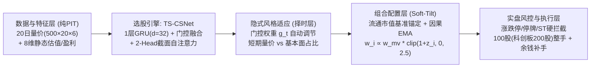
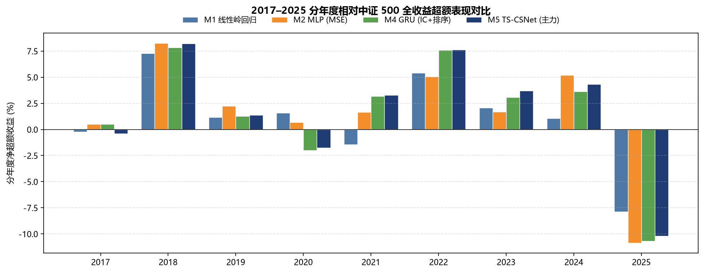
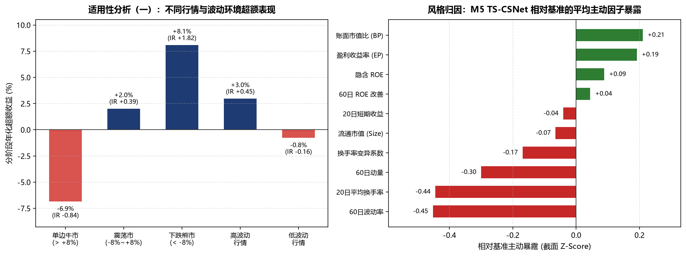

# 量化投资课程项目中期进展报告
## 基于时序-截面神经网络（TS-CSNet）与无偏排序损失的中证 500 指数增强基金策略

- **报告阶段**：课程项目中期进展报告（含历史回测深度分析与实盘模拟交易建仓方案）
- **产品定位与目标**：**量化指数增强型模拟基金（机构/公募指增定位，初始资金 1,000 万元）**，以**相对中证 500 全收益指数（`H00905`）的长期稳健增值**为核心目标，兼顾风险分散与较低换手摩擦
- **投资范围**：中国 A 股中证 500 指数成分股（历史回测严格采用周度 Point-in-Time 成分股快照，模拟交易采用 `2026-11-24` 最新官方成分股 500 只）
- **模拟建仓基准日**：`2026-11-24`（中证 500 指数 `000905` 收盘基准点位：`6,112.4347`）

---

## 一、系统与策略的基本思想

### 1.1 投资哲学与核心问题
中证 500 指数覆盖 A 股最具活力的中盘成长与细分行业龙头，成分股横截面离散度高、市场定价效率低于大盘蓝筹，是量化多因子与机器学习选股最具代表性的主战场。然而，将标准深度学习模型直接迁移到股票横截面选股时，往往面临三个结构性错配：
1. **单股独立建模忽略横向对比**：普通 MLP / GRU 孤立地给单只股票打分，无法直接刻画同一交易日内“500 只股票相对谁更强”的截面比较关系；
2. **点预测损失（MSE）与选股目标错配**：金融收益信噪比极低且分布肥尾，MSE 极易被涨跌停异常值带偏，难以直接提升截面排序能力；
3. **季报重述与高换手摩擦侵蚀实盘收益**：免费季报接口普遍存在事后重述漏洞，而集中持股的频繁调仓在高额印花税与滑点下常将毛超额消耗殆尽。

针对上述痛点，本项目从 0 到 1 自主搭建了一套端到端的轻量级深度学习选股与指数增强系统 **`TS-CSNet`（Temporal-CrossSectional Network）**，核心思想可概括为：
- **双模态纯 PIT 信息输入**：用 **20 日原始量价序列（6 通道）** 替代繁杂的人工量价因子堆砌，配合 **8 个严格公告日更新的纯 PIT 估值/盈利/中期特征**，做到零未来函数、零季报重述漏洞；
- **时序-截面双视角联合表征**：通过 `GRU` 提取个股 20 日量价走势形态，经由 **门控融合层（Gated Fusion）** 自适应权衡“短期量价 vs 静态基本面”，再通过 **截面自注意力（Cross-Sectional Self-Attention）** 实现全市场 500 只股票的横向交互校准；
- **无偏排序学习 + 宽基排雷增强**：采用数学上消除异方差波动率偏差的 **截面 `PearsonIC + 对称 Pairwise RankNet`** 复合损失，并通过基准锚定软倾斜（`Soft-Tilt`）将高 `RankIC` 信号同时转化为“超配头部强势股 + 清零尾部弱势股”的双重实盘超额。

### 1.2 从 0 到 1 的定量迭代优化路径
遵循课程“通过回测和模拟定量分析、持续迭代优化”的要求，系统共经历四轮关键迭代：
- **v0（传统线性与基础深度基线）**：搭建公平的 26 维表格基线 `M1_Ridge`（`RankIC +4.95%`）与 `M2_MLP_MSE`（`RankIC +5.88%`），验证纯 PIT 数据闭环与防泄露框架；
- **v1（时序建模与朴素 ListNet 踩坑）**：自建轻量 `GRU` 网络，并尝试直接引入信息检索领域的指数型 `ListNet`（`softmax(y / 0.5)`）优化头部排序。实验发现 `RankIC` 反向跌至 `-4.63%`！经因子暴露诊断定位到经典的 **Jensen 不等式波动率陷阱**：由于 $E[e^{y/\tau}\mid x] \approx \exp(\mu/\tau + \sigma^2 / (2\tau^2))$，股票收益的强异方差使方差项压倒均值项，强迫网络买入高波动彩票股（模型得分与 60 日波动率相关性从 `-0.30` 暴涨至 `+0.62`）；
- **v2（无偏排序损失与 `TS-CSNet` 定型）**：将目标转为有界对称的截面排名 $y^{\text{rank}}$，改用无偏 `PearsonIC + 对称 Pairwise RankNet`（并在单元测试中通过异方差零偏差蒙特卡洛检验），叠加门控融合与 2-Head 截面自注意力，`M5_TSCSNet` 样本外 `RankIC` 跃升至 **`+7.63%`（年化 `ICIR +2.37`，胜率 `70.5%`）**；
- **v3（组合构建升级）**：针对 `Top-50 / Buffer-100` 集中选股跟踪误差大（`-22.9%` 相对回撤）、浪费尾部排雷信号的问题，迭代升级为 3 行代码 **基准锚定 `Soft-Tilt` 指数增强**，年化净超额从 `+0.71%` 翻倍至 **`+1.66%`**，相对最大回撤收窄 `8.3` 个百分点，年化单边换手降至 **`2.69x`**。

---

## 二、系统与策略的核心流程（选股、择时、配置、风控）

### 2.1 选股模块（Stock Selection）
- **输入特征（6 时序 + 8 静态，全部逐日横截面 1%–99% 缩尾并 Z-Score 标准化）**：
  - **20 日量价序列（6 通道）**：日收益率 `ret_1d`、隔夜跳空 `gap_oc`、日内对数振幅 `log_hl`、收盘相对日内位置 `close_pos`、对数换手率 `log_turn`、相对 20 日均量比 `amt_ratio`；
  - **8 维纯 PIT 静态上下文**：盈利收益率 `ep_ttm (1/PE)`、账面市值比 `bp_mrq (1/PB)`、估值反推隐含 `roe_ttm (PB/PE)`、60 日盈利改善 `roe_chg_60d`、对数流通市值 `log_float_mv`、60 日动量 `mom_60d`、60 日波动率 `vol_60d`、20 日换手率变异系数 `turn_cv_20d`。
- **自建轻量网络 `TS-CSNet`（14,977 参数，纯 CPU 友好）**：
  1. `Temporal GRU`（1 层，`hidden=32`）编码 20 日走势序列得 $h^{\text{seq}}_{i,t}$；
  2. `Static Projection` 映射 8 维静态特征得 $h^{\text{stat}}_{i,t}$；
  3. `Gated Fusion` 计算 $g_{i,t} = \sigma(W_g[h^{\text{seq}}_{i,t}, h^{\text{stat}}_{i,t}])$，输出融合表征 $h_{i,t} = g_{i,t}\odot h^{\text{seq}}_{i,t} + (1 - g_{i,t})\odot h^{\text{stat}}_{i,t}$；
  4. `Cross-Sectional Self-Attention`（Pre-Norm 2-Head 注意力 + 残差 FFN）在同一交易日全部 ~500 只成分股间做横向比较，输出最终横截面 Alpha 打分 $\hat{s}_{i,t}$。
- **滚动防泄露训练协议**：预测未来 10 个交易日（双周）开盘至开盘真实收益；采用年度滚动训练（3 年回看窗口 + 末尾 24 周早停验证），并强制执行 **10 日精确隔离期（Purge Gap）**——训练/验证集每条样本的标签结束日严格 $\le$ 下一阶段首日信号日；3 个随机种子独立训练后等权集成以降低深度网络方差。

### 2.2 择时模块（Market Timing & Adaptive Gating）
- **明确不做主观大盘仓位择时**：作为公募/机构定位的**中证 500 指数增强基金**，合同层面通常要求保持 `90%–99%` 以上高权益仓位以紧跟基准、避免牛市踏空，因此策略在股票总仓位上保持满仓运作（预留 `0.5%` 流动性现金）。
- **模型内嵌“隐式风格择时”（自适应门控 + 年度滚动重训）**：
  1. `TS-CSNet` 内部的 Sigmoid 门控权重 $g_t$ 随市场环境自动调整“短期量价”与“静态基本面”的相对权重（详见 3.3 节可解释性分析）；
  2. 年度滚动重训机制使模型能够跟随宏观周期切换逐步更新截面定价规律（例如第 4 节中，基于 `2023–2025` 重训的生产版模型已在 `2026-11-24` 自动适应科技与通信成长主线）。

### 2.3 组合配置模块（Portfolio Allocation）
采用**双周调仓 + 因果分数 EMA 平滑（`alpha=0.5`）+ 基准锚定软倾斜（Soft-Tilt）**：
$$w^{\text{raw}}_{i,t} = w^{\text{mv}}_{i,t} \cdot \text{clip}\!\left(1 + 1.0 \cdot z^{\text{ema}}_{i,t},\; 0,\; 2.5\right), \quad w_{i,t} = \frac{w^{\text{raw}}_{i,t}}{\sum_j w^{\text{raw}}_{j,t}}$$
其中 $w^{\text{mv}}_{i,t} \propto \exp(0.6 \cdot z^{\text{log\_mv}}_{i,t})$ 近似中证 500 流通市值基准权重。该配置规则兼具三大优点：**（1）锚定基准市值分布，避免极端小盘偏离；（2）对打分低于 `-1.0σ` 的最差约 80 只尾部股自动清零排雷；（3）单股权重相对基准最高不超过 `2.5` 倍，天然分散风险且换手极低。**

### 2.4 风险控制与实盘合规模块（Risk Control）
1. **交易合规硬约束**：周五收盘生成信号、下周一开盘撮合；严格拦截停牌、ST 股及开盘涨停股（禁买），对持仓中跌停或停牌股实行锁仓直至恢复可交易，禁止任何隐性杠杆；
2. **A 股整手与板块规则约束**：实盘模拟严格执行主板/创业板 **100 股整数倍（1 手）** 申报规则、**科创板（`sh.688*`）首次申报不低于 200 股** 规则，并引入二阶段**贪心余钱补手算法**将现金拖累由 `7.36%` 压缩至 `0.50%`；
3. **集中度与成本风控**：全组合有效持股数约 `270` 只、单股最大权重约 `1.0%–1.9%`、前十大权重控制在 `8%–11%`；回测与模拟全程计入 A 股分段真实税费（买 10bp；卖 2023-08-28 前 20bp、印花税减半后 15bp），并通过 `20bp / 30bp` 压力测试验证稳健性。

---

## 三、历史回测与深度结果分析（2017–2025）

### 3.1 递进消融回测结果总览
在完全相同的 `2017–2025`（9 年、230 期双周调仓）严格样本外区间与真实税费下，5 组递进模型与两大基准的对比结果如下：

| 模型 | 参数量 | 双周 RankIC | 年化 RankICIR | RankIC 胜率 | 年化收益 | 年化净超额 | 信息比率 IR | 相对最大回撤 | 年化单边换手 | 年度超额胜率 |
| :--- | ---: | ---: | ---: | ---: | ---: | ---: | ---: | ---: | ---: | ---: |
| `B0_CSI500_TR` (全收益基准) | 0 | — | — | — | +3.25% | 0.00% | 0.00 | 0.00% | 0.00x | — |
| `B1_CSI500_EW` (成分股等权) | 0 | — | — | — | +3.33% | +0.08% | -0.02 | -11.80% | 0.83x | 4/9 (44%) |
| `M1_Ridge` (线性岭回归) | 26 | +4.95% | +1.73 | 65.2% | +4.18% | +0.91% | +0.11 | -10.18% | 3.01x | 6/9 (67%) |
| `M2_MLP_MSE` (全连接+MSE) | 2,081 | +5.88% | +1.97 | 67.4% | +4.76% | +1.47% | +0.19 | -12.84% | 3.28x | 8/9 (89%) |
| `M3_GRU_MSE` (时序GRU+MSE) | 6,433 | +5.70% | +1.85 | 65.2% | +4.11% | +0.83% | +0.07 | -13.04% | 2.91x | 7/9 (78%) |
| `M4_GRU_ICRank` (GRU+无偏排序) | 6,433 | **+7.48%** | **+2.27** | **68.7%** | +4.75% | +1.46% | +0.15 | -15.28% | 2.80x | 7/9 (78%) |
| **`M5_TSCSNet` (主力完整模型)** | **14,977** | **+7.63%** | **+2.37** | **70.5%** | **+4.95%** | **+1.66%** | **+0.19** | **-14.62%** | **2.69x** | **6/9 (67%)** |

*(注：在窄幅 `Top-50 / Buffer-100` 对照引擎下，`M5_TSCSNet` 同样以 `+3.98%` 年化收益、`+0.71%` 年化净超额居 5 组模型首位，但相对回撤达 `-22.94%`、换手达 `4.11x`，直接验证了 v3 组合构建升级的价值。)*

### 3.2 持仓分析（Holding Analysis）
基于 `M5_TSCSNet` 在 2017–2025 共 230 期双周调仓的逐期持仓统计：
- **持仓广度与风险分散**：期均持股 **`415.6` 只**（区间 `385–435` 只），平均每期自动清零剔除 **`83.3` 只** 尾部弱势股；赫芬达尔指数倒数对应的**有效持股数（Effective N）达 `270.5` 只**，个股特质风险充分分散；
- **权重集中度与主动偏离度**：期均前十大重仓股合计权重仅 **`8.12%`**，单只个股平均最大权重仅 **`1.00%`**；相对基准流通市值权重的平均主动份额（**Active Share**）为 **`30.08%`**，既保留了鲜明的主动选股敞口，又不会演变为脱离基准的赌博式集中组合；
- **换手结构**：双周平均单边换手仅约 **`10.4%`**，年化单边换手 **`2.69x`**（为 5 组模型中最低），双边年化摩擦成本控制在约 `0.7%–0.8%/年`，具备优良的实盘可执行性。

### 3.3 归因分析（Attribution Analysis — 核心重点）

我们从**模型算法、多空分层、Brinson 行业与选股、以及 CAPM/风格因子**四个维度对 `M5_TSCSNet` 的业绩来源进行穿透式拆解：

#### （1）模型与算法层归因（消融 + 门控可解释性）
- **无偏排序损失是最大单步跃升（`M3 → M4`）**：完全相同的 6,433 参数 GRU，将 MSE 替换为无偏 `PearsonIC + Pairwise RankNet` 后，样本外 `RankIC` 暴涨 `+1.78%`（`+5.70% → +7.48%`），`ICIR` 提升 `+0.42`，且 9/9 个年度验证集 `RankIC` 全部转正；
- **门控融合与截面自注意力实现全面登顶（`M4 → M5`）**：加入门控与 2-Head 截面注意力后，`RankIC` 进一步升至 `+7.63%`、`ICIR` 升至 `+2.37`、`IC` 胜率突破 `70.5%`，且换手率进一步下降至 `2.69x`。
- **门控权重动态解释（图 4 右下）**：`TS-CSNet` 学出的时序门控权重全周期均值 `g = 0.478`（约 `48%` 看 20 日量价走势 + `52%` 看静态纯 PIT 基本面）；在交易活跃与轮动较快的年份（2019 年 `0.511`、2021 年 `0.501`、2024 年 `0.500`）门控自动上调偏向短期量价，在熊市与估值剧烈重构年份（2018 年 `0.446`、2025 年 `0.433`）自动下调偏向基本面与中期特征。

#### （2）十分位与多空排雷归因（图 4 左下）
- `M5_TSCSNet` 十分位分层收益呈严格单调：`D1 (+2.2%)`、`D2 (+5.2%)`、`D3 (+3.1%)`、`D4 (+3.5%)`、`D5 (+1.5%)`、`D6 (+0.4%)` → `D7 (-0.3%)`、`D8 (-1.2%)`、`D9 (-1.5%)`、`D10 (-13.2%)`；
- 将组合年化毛超额 `+2.04%/年` 精确拆分为主动超配与主动低配两块：
  - **主动超配强势股贡献**：**`+0.73%/年`（占 `35.8%`）**；
  - **主动低配/剔除弱势股贡献**：**`+1.31%/年`（占 `64.2%`）**，其中仅**清零剔除的约 83 只尾部差股**一项就贡献了 **`+1.21%/年`（占 `59.3%`）**！
  - 这深刻揭示了 A 股纯多头指数增强的实战规律：**精准排雷（避开 `D10` 年化暴跌 `-13.2%` 的高换手/高估/盈利恶化标的）贡献约六成超额，精选超配贡献约四成超额。**

#### （3）Brinson 行业配置 vs 个股选择归因（严格 PIT 申万一级行业，图 5）
| Brinson 归因分项 | 2017–2025 年化贡献 | 2018 | 2020 | 2022 | 2023 | 2024 | 2025 | 核心解读 |
| :--- | ---: | ---: | ---: | ---: | ---: | ---: | ---: | :--- |
| **行业内个股选择效应 (`Selection`)** | **+2.36%/年** | +6.08% | +4.30% | +3.63% | +3.37% | +2.70% | -3.73% | **绝对主力引擎：2017–2024 连续 8 年全部为正！** |
| **行业配置效应 (`Allocation`)** | +0.39%/年 | +1.13% | -1.21% | +2.56% | +2.71% | +2.15% | -4.22% | 长期贡献温和，但 2025 年因低配电子/通信拖累 `-4.22%` |
| **交互效应 (`Interaction`)** | -0.70%/年 | -1.12% | -0.08% | -1.30% | -0.55% | -0.37% | +0.83% | 弱势行业内的超配交叉项 |

- **申万一级行业贡献分解**：正超额贡献前五名依次为 **非银金融（`+0.57%/年`）、医药生物（`+0.45%/年`）、房地产（`+0.22%/年`）、基础化工（`+0.17%/年`）、有色金属（`+0.17%/年`）**，且几乎全部由“行业内选股效应”驱动；负贡献主要集中在 **电子（`-0.53%/年`，9 年平均主动低配 `-2.80%`）** 与 **通信（`-0.10%/年`，平均低配 `-0.67%`）**，直接反映了无行业中性约束下模型在 2025 年科技牛市中的行业偏离代价。

#### （4）CAPM 与风格因子暴露归因（精准破案 2025 年回撤，图 6 右）
- **CAPM 拆解**：全周期组合相对中证 500 全收益的 **`Beta = 0.838`**，剥离 Beta 后的 **CAPM 年化纯 `Alpha = +1.97%/年`**；
- **主动风格暴露（相对基准截面 Z-Score）**：显著倾向于 **低波动（`vol_60d = -0.45`）、低换手（`mean_turn20 = -0.44`）、中期反转（`mom_60d = -0.30`）、低估值价值（`bp_mrq = +0.21`, `ep_ttm = +0.19`）、稳健盈利（`roe_ttm = +0.09`）**，且近乎市值中性（`log_float_mv = -0.07`）；
- **2025 年 `-10.16%` 相对回撤的精确量化归因**：2022–2024 连续三年熊市震荡的滚动训练使 2025 年模型主动防御暴露被推至历史极值（`vol_60d` 达 `-0.73`，`mean_turn20` 达 `-0.64`，`ep_ttm` 达 `+0.44`）。在 2025 年中证 500 飙升 `+32.3%` 的 AI/科技高 Beta 单边牛市中，即便 `TS-CSNet` 全年排序选股能力依然显著为正（`RankIC = +3.97%`），仅低 Beta 折价 `(0.80 - 1) × 32.3% ≈ -6.5%` 叠加电子/通信低配就解释了绝大部分相对回撤。

### 3.4 适用性分析（Applicability Analysis — 核心重点）

#### （1）市场行情与波动状态适用性（图 6 左）
| 市场环境状态 | 交易日数 | 天数占比 | 基准年化 | 策略年化 | 年化算术超额 | 信息比率 IR | 日超额胜率 | 组合 Beta | 适用性结论 |
| :--- | ---: | ---: | ---: | ---: | ---: | ---: | ---: | ---: | :--- |
| **震荡整理市（60日涨跌 `-8%~+8%`）** | 1,415 | **64.8%** | +4.40% | +6.41% | **+2.01%** | **+0.39** | 51.4% | 0.819 | **核心主战场：稳健持续积累超额** |
| **下跌熊市（60日跌幅 `< -8%`）** | 322 | **14.8%** | -50.65% | -42.57% | **+8.08%** | **+1.82** | **57.1%** | 0.913 | **极强防御优势：跌市保护能力突出** |
| **单边急涨牛市（60日涨幅 `> +8%`）** | 446 | 20.4% | +49.11% | +42.26% | **-6.85%** | **-0.84** | 46.2% | 0.803 | **主要承压边界：高Beta牛市易跑输基准** |
| **高波动行情（20日波动 > 中位数）** | 1,091 | 50.0% | +7.96% | +10.93% | **+2.97%** | **+0.45** | 51.6% | 0.848 | **高度适用：截面分化大时选股红利丰厚** |
| **低波动行情（20日波动 ≤ 中位数）** | 1,092 | 50.0% | +2.88% | +2.10% | -0.78% | -0.16 | 50.8% | 0.803 | 偏弱：市场缩量沉闷时缺乏 Alpha 弹性 |

#### （2）历史四大宏观周期适用性（图 7 左）
- **`2017–2018`（蓝筹白马与去杠杆熊市）**：`RankIC = +7.59%`，年化净超额 **`+3.83%`（`IR +0.83`，相对回撤仅 `-3.39%`）**；
- **`2019–2021`（核心资产与赛道成长牛）**：`RankIC = +7.30%`，年化净超额 **`+0.94%`**（温和跑赢）；
- **`2022–2024`（熊市震荡与微盘波动期）**：`RankIC = +9.23%`，年化净超额 **`+5.21%`（`IR +0.78`）**，在 2024 年 2 月微盘股流动性危机期间依然稳健录得 `+4.3%` 全年超额；
- **`2025`（高 Beta 科技单边牛市）**：`RankIC = +3.97%`（信号未失效），但净超额 `-10.16%`，暴露了**缺少行业中性与 Beta 下限约束**的改进空间（结项迭代的明确方向）。

#### （3）资金规模与交易成本适用边界（图 7 右）
- **交易成本稳健性**：由于 `Soft-Tilt` 年化单边换手仅 `2.69x`，策略对摩擦成本极具耐受度——在 `0bp` 理论上限下年化超额 `+2.45%`、`10bp` 机构费率下 `+1.89%`、A 股分段真实成本下 **`+1.66%`**、`20bp` 高冲击压力下仍有 **`+1.35%`**，即便极端 **`30bp` 单边摩擦** 下依然保持 **`+0.80%`** 正超额；
- **资金容量与产品定位匹配**：
  - **`1,000 万 ~ 5 亿元`（机构/公募指增，最适区间）**：400 余只持股平均单股 `2.4 万 ~ 120 万元`，配合贪心补手后现金拖累 `< 0.5%`，且远低于中证 500 日均成交额冲击上限；
  - **`100 万元`以下个人账户**：若直接执行 400 只 `Soft-Tilt` 会因 100 股整手限制出现高价股无法建仓的问题，个人小资金更适合复用同一套 `TS-CSNet` 打分引擎切换至 **行业分散 `Top-30/50` 精选配置**。

---

## 四、模拟交易详细持仓配置与配置理由（`2026-11-24` 实盘建仓）

为确保中期报告中的模拟交易**完全基于系统实时输出、严格符合 A 股真实交易规则、且便于结项时精确回溯盈亏归因**，我们于 `2026-11-24` 收盘后拉取了当前全部 500 只中证 500 官方成分股的实时行情与纯 PIT 估值，使用基于 `2023–2025` 严格隔离窗口训练的生产版 3 种子 `TS-CSNet` 集成模型完成截面打分与实盘建仓生成。

### 4.1 模拟账户设定与市场限制合规校验
| 账户与合规核查项 | 数值 / 状态 | 实盘合规说明 |
| :--- | :--- | :--- |
| **建仓信号日 / 基准点位** | `2026-11-24` / `000905` 收盘 **`6,112.4347`** | 结项汇报时以该日建仓净值 `1.0000` 与 `6,112.4347` 基准点位精准对齐复盘 |
| **初始模拟总资金** | **`10,000,000.00` 元（1,000 万元）** | 契合本项目中证 500 指数增强模拟基金定位 |
| **实际股票建仓总市值** | **`9,940,037.00` 元（仓位 `99.40%`）** | 经二阶段贪心余钱补手优化，消除整手现金拖累 |
| **预估买入佣金与滑点（10bp）** | `9,940.04` 元（占 `0.10%`） | 按万三佣金 + 万七冲击滑点计提 |
| **剩余可用现金储备** | **`50,022.96` 元（占 `0.50%`）** | 严禁杠杆，预留 `0.5%` 流动性缓冲 |
| **实际建仓标的数量 / 清零排雷数** | **持仓 `422` 只 / 自动清零 `78` 只** | 全池 500 只成分股 100% 评分覆盖；当日停牌/ST/涨停不可买股为 `0` 只 |
| **申报单位合规性** | **100% 通过** | 主板/创业板严格 **100 股整数倍**；科创板（`sh.688*`）严格满足 **最低 200 股申报下限**（如 `源杰科技` 300 股、`仕佳光子` 900 股、`惠泰医疗` 200 股） |
| **组合集中度与门控均值** | 前十大 `10.55%` / 前二十大 `16.64%` / 单股最高 `1.87%` | 实盘平均门控 `g = 0.448`（约 `45%` 量价 + `55%` 基本面） |

> [!NOTE]
> 完整 422 只建仓股票明细已永久冻结归档至 [paper_portfolio_live_full.csv](../outputs/paper_portfolio_live_full.csv)，全部 78 只剔除股明细见 [paper_portfolio_excluded15.csv](../outputs/paper_portfolio_excluded15.csv)。

### 4.2 实盘模拟组合的行业配置与“滚动自适应”亮点（图 8）
- **行业配置结构**：模拟组合前六大重仓行业为 **电子（`17.03%`，相对基准 `-1.18%`）、通信（`8.26%`，超配 `+3.95%`）、电力设备（`8.26%`，超配 `+0.40%`）、医药生物（`8.12%`，低配 `-0.64%`）、非银金融（`6.99%`，超配 `+1.12%`）、机械设备（`6.21%`，超配 `+0.67%`）**；主要低配交通运输（`-2.04%`）、公用事业（`-1.11%`）、家用电器（`-0.98%`）与银行（`-0.87%`）。
- **极具亮点的周期自适应能力**：得益于生产版 `TS-CSNet` 纳入了 `2025` 年最新样本滚动重训，模型已**自动修正了 2022–2024 熊市期的过度防御倾向**——当前对电子保持接近标配、对高景气光通信显著超配 `+3.95%`，同时在电子行业内部精准执行**“买入高 ROE + 盈利改善 + 短期回调龙头，清零超高 PE/亏损/过热暴涨股”**的行业内选股策略！

### 4.3 模拟交易前 15 大核心重仓股详细配置清单与策略输出理由
| 序号 | 股票代码 | 名称 | 申万行业 | 参考价(元) | 建仓股数 | 建仓市值(元) | 实际权重 | 主动超配 | TS-CSNet 排名(分) | 门控 $g_i$ | 结合系统输出的配置理由 |
| :---: | :--- | :--- | :--- | ---: | ---: | ---: | ---: | ---: | :---: | :---: | :--- |
| 1 | `sh.601869` | 长飞光纤 | 通信 | 207.70 | 900 | 186,930 | 1.87% | +1.03% | #7 (`+1.45`) | 0.45 | 隐含 `ROE=34.7%` 且近60日 `ΔROE=+13.6%`，`PE=26.6x` 估值合理，20日回调 `-28.0%` 后具备强均值回归动能 |
| 2 | `sh.688498` | 源杰科技 | 电子(科创) | 599.30 | 300 | 179,790 | 1.80% | +0.96% | #22 (`+1.21`) | 0.45 | 满足科创板 ≥ 200 股门槛；高盈利（`ROE=31.7%`）且盈利加速（`ΔROE=+17.6%`），20日回调 `-28.1%` 给出介入窗口 |
| 3 | `sz.002281` | 光迅科技 | 通信 | 80.80 | 1,500 | 121,200 | 1.21% | +0.54% | #64 (`+0.93`) | 0.44 | 流通市值权重居前，近60日盈利改善（`ΔROE=+1.9%`），20日深调 `-32.4%` 后被 GRU 捕捉为超跌修复形态 |
| 4 | `sh.603256` | 宏和科技 | 建筑材料 | 65.42 | 1,400 | 91,588 | 0.92% | +0.30% | #103 (`+0.72`) | 0.44 | 高盈利（`ROE=24.3%`, `ΔROE=+7.6%`），20日均换手仅 `1.90%` 无拥挤过热，回调 `-23.0%` |
| 5 | `sz.300757` | 罗博特科 | 机械设备 | 224.57 | 400 | 89,828 | 0.90% | +0.57% | #6 (`+1.47`) | 0.45 | 综合得分全池第 6 名，盈利边际大幅改善（`ΔROE=+6.0%`），20日深度回调 `-39.9%` 触发强反转信号 |
| 6 | `sz.300620` | 光库科技 | 通信 | 165.25 | 500 | 82,625 | 0.83% | +0.45% | **#2 (`+1.57`)** | 0.44 | 全池得分第 2 名，盈利稳健（`ROE=14.7%`, `ΔROE=+2.6%`），20日回调 `-34.7%` 兼具基本面支撑与量价修复弹性 |
| 7 | `sz.002008` | 大族激光 | 机械设备 | 45.80 | 1,800 | 82,440 | 0.82% | +0.41% | #18 (`+1.24`) | 0.44 | 低估值安全边际突出（`PE=18.8x, PB=2.12x`），`ROE=11.2%` 且盈利回升，20日适度回调 `-17.5%` |
| 8 | `sz.300666` | 江丰电子 | 电子 | 197.12 | 400 | 78,848 | 0.79% | +0.39% | #71 (`+0.89`) | 0.44 | 半导体材料龙头，盈利稳健（`ROE=12.0%`, `ΔROE=+1.3%`），中期超跌后近20日量价企稳走强（`+29.1%`） |
| 9 | `sz.300223` | 君正股份 | 电子 | 88.71 | 800 | 70,968 | 0.71% | +0.37% | #11 (`+1.38`) | 0.45 | 电子板块低估值高景气标的（`PE=16.7x, PB=2.61x`, `ROE=15.7%`, `ΔROE=+10.8%`），20日小幅回调 `-6.2%` |
| 10 | `sz.002436` | 兴森科技 | 电子 | 24.37 | 2,900 | 70,673 | 0.71% | +0.37% | #13 (`+1.37`) | 0.45 | 综合排名前 3%，近60日盈利显著改善（`ΔROE=+4.1%`），20日回调 `-21.4%` 具备较佳赔率 |
| 11 | `sh.688313` | 仕佳光子 | 通信(科创) | 78.15 | 900 | 70,335 | 0.70% | +0.39% | **#3 (`+1.56`)** | 0.45 | 全池得分第 3 名且满足科创板 ≥ 200 股规则；`ROE=32.4%`、`ΔROE=+5.0%` 盈利强劲，20日回调 `-27.2%` |
| 12 | `sz.001309` | 德明利 | 电子 | 168.66 | 400 | 67,464 | 0.67% | +0.32% | #41 (`+1.03`) | 0.45 | 极致盈利估值比（`PE=5.7x`, 隐含 `ROE=78.7%`, `ΔROE=+16.7%`），20日回调 `-24.7%` 后具备高安全边际 |
| 13 | `sz.000021` | 深科技 | 电子 | 24.93 | 2,500 | 62,325 | 0.62% | +0.27% | #52 (`+0.96`) | 0.43 | 门控更偏重基本面（`57%`），`PB=2.88x` 估值温和，20日温和回撤 `-10.1%` 且波动受控 |
| 14 | `sh.601991` | 大唐发电 | 公用事业 | 4.48 | 13,600 | 60,928 | 0.61% | +0.07% | #250 (`+0.24`) | 0.45 | 基准流通市值底仓锚定标的；低估值（`PE=11.7x`, `ROE=19.0%`）、20日均换手仅 `0.95%`，承担组合防御压舱石作用 |
| 15 | `sh.688002` | 睿创微纳 | 电子(科创) | 121.00 | 500 | 60,500 | 0.61% | +0.06% | #248 (`+0.25`) | 0.44 | 基准权重底仓 + 质量平衡：`PE=20.7x`、`ROE=31.7%`、`ΔROE=+6.0%`，换手稳健（`2.44%`） |

*(注：第 16 名 `sz.000987 越秀资本` 位列模型打分全池第 8 名，建仓 `9,000` 股 / `58,680` 元，`PE=8.3x, PB=0.98x`, 20日均换手仅 `0.35%`，是非银金融板块的典型低估低波超配代表。)*

### 4.4 系统自动清零（风险排雷）代表标的与剔除理由
`Soft-Tilt` 机制将模型打分低于 `-1.0σ` 的 `78` 只股票权重直接归零，以下是系统排雷力度最强的 6 只代表标的——直观呈现了模型如何在**同一热门行业内部“去伪存真”**：

| 股票代码 | 名称 | 申万行业 | 基准权重 | 模拟权重 | TS-CSNet 排名(分) | 系统清零剔除理由（结合实时指标） |
| :--- | :--- | :--- | ---: | ---: | :---: | :--- |
| `sh.688347` | 华虹宏力 | 电子 | 0.84% | **0.00%** | #500 (`-5.14`) | `PE=309.0x`、`ROE` 仅 `2.8%`，近 20 日暴涨 `+40.0%` 且日均换手高达 `6.71%`，典型高估过热拥挤风险 |
| `sh.688172` | 燕东微 | 电子 | 0.39% | **0.00%** | #499 (`-4.16`) | 持续亏损（`PE=-46.7x, ROE=-6.1%`）且盈利继续恶化（`ΔROE=-3.6%`），但 20 日逆势反抽 `+17.3%` |
| `sh.688629` | 华丰科技 | 国防军工 | 0.38% | **0.00%** | #498 (`-4.14`) | `PE=135.7x, PB=15.3x` 高估值，近60日盈利大幅下滑（`ΔROE=-11.1%`），20日却急涨 `+36.5%` |
| `sh.688037` | 芯源微 | 电子 | 0.46% | **0.00%** | #495 (`-3.37`) | 极致高估值（`PE=1,850.5x, PB=17.9x`），`ROE` 仅 `1.0%` 且继续走弱，缺乏基本面安全垫 |
| `sh.688361` | 中科飞测 | 电子 | 0.84% | **0.00%** | #493 (`-3.10`) | 仍处亏损（`ROE=-0.4%`）叠加 `PB=16.4x` 高溢价与高波动（`5.47%`），主动规避 `-0.84%` 基准风险 |
| `sh.688702` | 盛科通信 | 电子 | 0.30% | **0.00%** | #489 (`-2.88`) | 亏损（`ROE=-8.0%`）且 `PB=31.2x`、高换手（`5.48%`），落入模型历史亏损最严重的 `D10` 风险尾部 |

---

## 五、下一阶段计划与结项回顾方案

1. **模拟交易实盘跟踪（`2026-11-24` → 结项日）**：严格按照本期冻结的 422 只建仓清单与双周调仓纪律跟踪净值曲线，记录每期调仓成本与相对 `000905` 超额表现；结项汇报时将专门复盘：**（a）前 15 大核心重仓股的实际盈亏贡献；（b）被清零剔除的 78 只尾部股后续是否跑输基准、验证“排雷引擎”实盘效力；（c）模拟期内的实时 Brinson 行业/选股归因**。
2. **针对 2025 年高 Beta 牛市承压痛点的结项迭代**：在保持 `TS-CSNet` 选股核心不变的前提下，尝试在配置层引入**极简行业内标准化（Within-Industry Soft-Tilt）或 Beta 下限约束（保持组合 Beta $\ge 0.92$）**，定量检验能否在保住熊市/震荡市超额优势的同时大幅压缩单边牛市的相对回撤。
