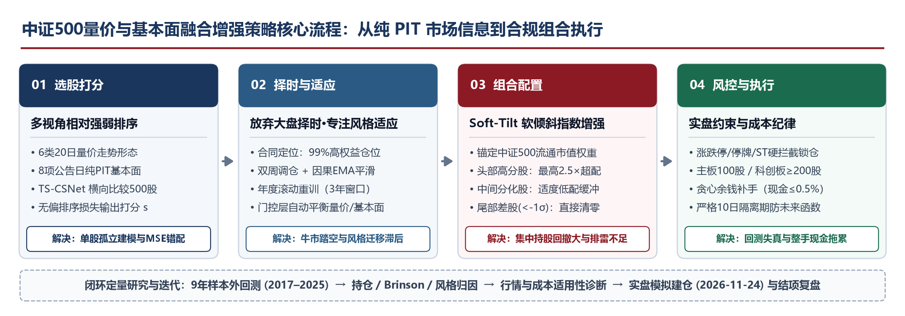
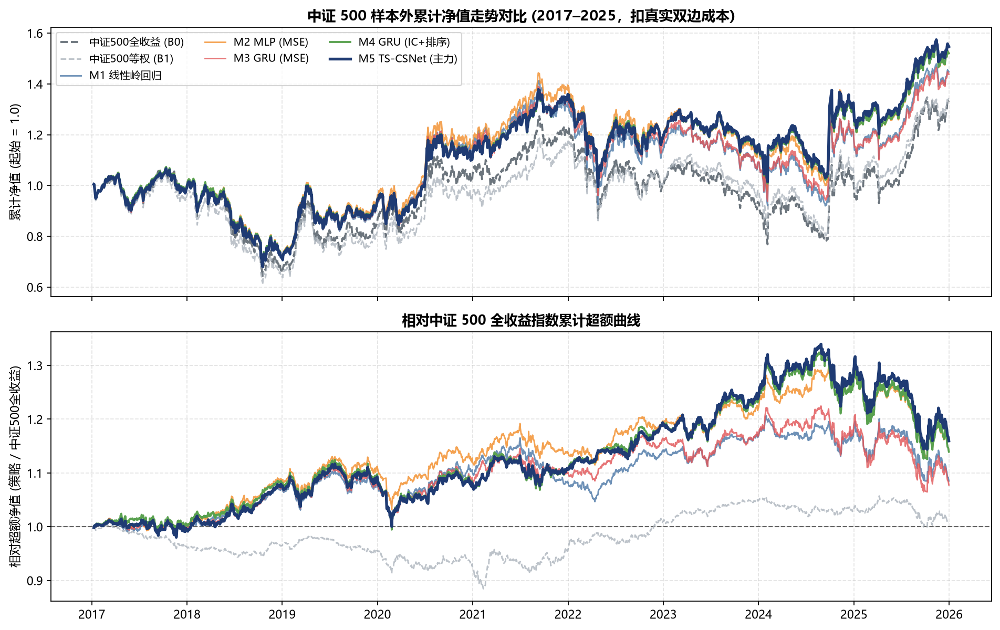
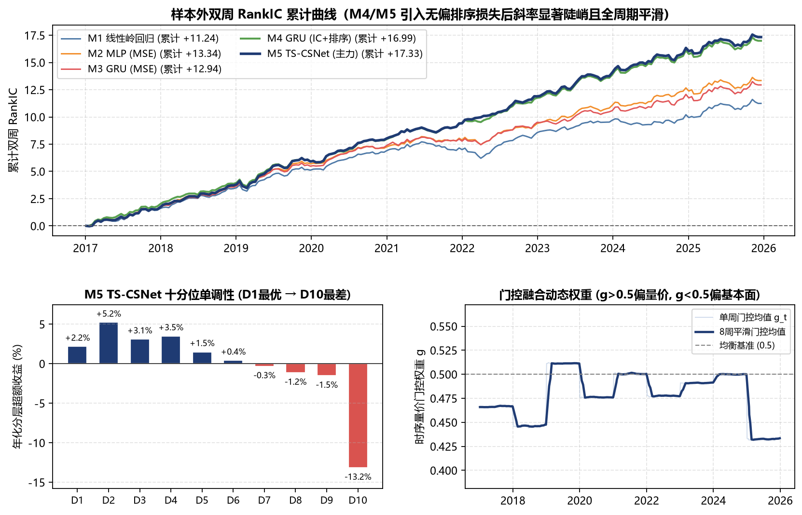
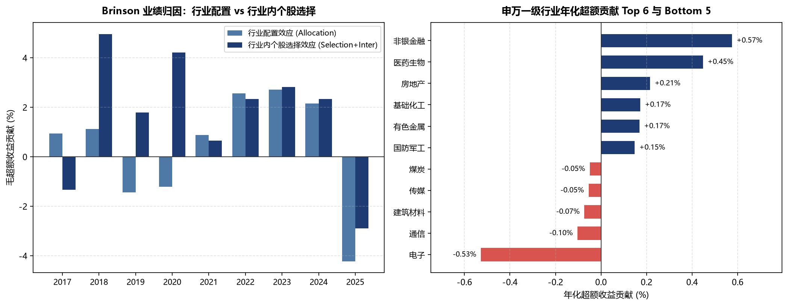
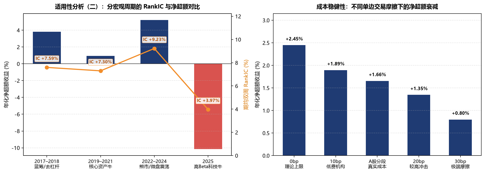
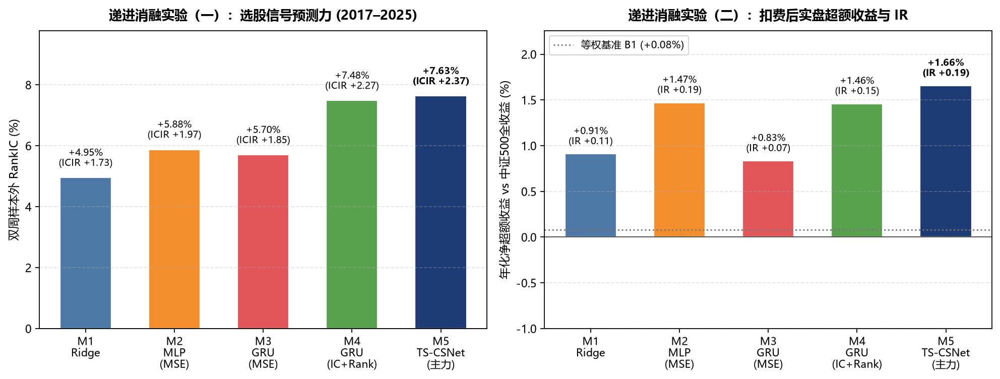
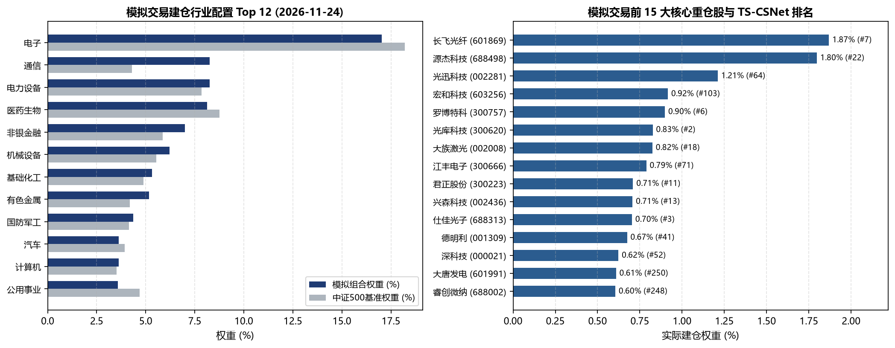

# 量化投资课程项目中期进展报告
## 中证500量价与基本面融合增强策略

| 项目基本信息 | 内容说明 |
| :--- | :--- |
| **策略名称** | **中证500量价与基本面融合增强策略** |
| **策略定位与资金规模** | 机构/公募定位的**中证 500 量化指数增强模拟基金**，初始模拟资金 **1,000 万元人民币** |
| **投资目标与业绩基准** | 在严控跟踪偏离与实盘摩擦前提下，力争相对**中证 500 全收益指数（`H00905`）**获取长期稳健的净超额收益（增值导向） |
| **投资范围** | A 股中证 500 指数成分股（历史回测采用 562 期周度 PIT 快照共 1,323 只历史成分股；模拟建仓采用 `2026-11-24` 最新官方 500 只成分股） |
| **建仓基准日与点位** | `2026-11-24`（中证 500 指数 `000905` 收盘基准点位 `6,112.4347`；本报告严格区分**模拟建仓计划**与后续**实际模拟成交结果**） |

---

## 一、策略背景与基本投资思想（约占 15%）

### 1.1 为什么选择中证 500 指数增强策略？
在 A 股主流宽基指数中，沪深 300 偏重金融与大盘蓝筹、机构定价高度充分、个股分化度相对有限；中证 1000 与微盘股虽然弹性高，但流动性约束突出、在极端风格踩踏中易发生剧烈回撤（如 2024 年 2 月微盘股流动性危机）。相比之下，**中证 500 指数**具备三项独特的量化投资优势：
1. **横截面收益离散度高、定价效率适中**：覆盖 500 只细分行业中盘龙头与成长股，涵盖电子、医药生物、电力设备、通信、非银金融、机械设备等核心产业链，信息不对称与行为偏差提供了更充裕的选股 Alpha 土壤；
2. **流动性与容量均衡**：成分股日均成交活跃，能够支撑 `1,000 万` 至亿元级资金在不造成严重市场冲击的前提下完成双周再平衡；
3. **契合“相对基准稳健增值”的基金目标**：以 `H00905`（含分红再投资的中证 500 全收益指数）作为严格业绩基准，既能防止在单边牛市中因踏空权益仓位而失血，又能通过系统化的选股与排雷持续增厚长期复利。

### 1.2 核心因子体系及其金融经济学逻辑
为了确保策略逻辑清晰、经济含义直观且**彻底杜绝免费季报接口的事后重述漏洞**，本项目仅使用**交易日收盘即可获取的纯 Point-in-Time（PIT）市场与估值数据**，构建三类经典金融信息：
- **短期量价行为特征（过去 20 个交易日走势）**：包含日收益率、隔夜跳空、日内振幅、收盘相对位置、换手率水平与相对放量比。其金融逻辑源于 A 股散户占比高带来的**短期过度反应与交易拥挤效应**——短期急涨伴随异常放量高换手的标的往往透支未来收益，而量价平稳、适度回调的优质标的更具均值回归修复潜力；
- **估值与安全边际因子（`EP_TTM`、`BP_MRQ`）**：衡量单位市值对应的盈利与净资产支撑。在长期定价中，低估值标的提供了更高的风险补偿与下行保护；
- **盈利质量与景气改善因子（隐含 `ROE_TTM = PB/PE`、60 日 `ΔROE`、中期动量与波动率）**：通过公告日实时更新的估值比值反推真实盈利能力及其边际改善，有效识别“低估值陷阱”（便宜但持续亏损）与“真成长”（盈利加速且估值合理）。

### 1.3 超额收益的获取机制与引入机器学习的投资价值
在纯多头（不可随意融券做空）的 A 股指数增强框架下，策略获取超额收益并非依赖孤立预测某只股票涨跌几个百分点，而是依赖**双轮驱动的相对强弱配置**：
1. **头部超配（精选赢家）**：在基准权重基础上，对截面综合评分排名前列的优质标的适度加仓；
2. **尾部低配与清零（精准排雷）**：对高估值、盈利恶化或交易极度过热的尾部弱势股果断减配乃至权重归零——正如后文归因分析所证实的，在 A 股多头指增中，“避开大跌的差股”与“买中大涨的好股”同等重要。

**为什么引入机器学习，而不是停留在传统线性多因子打分？** 传统线性打分（如等权打分或岭回归）隐含两条脆弱假设：因子与收益呈线性关系、各因子之间彼此独立。但在真实市场中，因子效应存在显著的**条件交互与形态依赖**——例如，同样是过去 20 日上涨 10%，“缩量温和上行 + 盈利改善”往往是健康趋势，而“巨量换手 + 尾盘急拉 + 估值透支”则是派发见顶信号。引入轻量级机器学习模型的核心价值，正是为了**自动刻画多维量价走势形态与基本面之间的非线性交互，并在同一交易日的 500 只股票之间进行横向相对排序**，而非替代金融投资逻辑本身。

---

## 二、策略核心流程：选股、择时、配置、风控（约占 25%）

本策略构建了“纯 PIT 数据输入 → 多视角选股打分 → 滚动与门控风格适应 → Soft-Tilt 权重配置 → 实盘合规风控”的完整投资闭环（见下图）。四个业务模块各司其职、紧密协同，共同服务于“提升选股准确率、降低摩擦成本、控制尾部风险”的投资目标。

### 2.1 选股模块：基于时序-截面排序的 `TS-CSNet` 打分系统
选股模块解决的核心投资问题是：**如何在低信噪比、肥尾分布的 A 股市场中，每天从 500 只成分股里更准确地识别出相对强势股与相对弱势股？**

在不陷入复杂算法细节的前提下，自建轻量级模型 **`TS-CSNet`（仅约 1.5 万参数，普通 CPU 即可复现）** 在投资逻辑上只做三件非常直观的事：
1. **读懂 20 日量价走势形态**：先用轻量时序模块消化每只股票过去 20 天的涨跌节奏、振幅与换手变化，替代人工拼凑几十个易过拟合的短期技术指标；
2. **动态权衡“量价”与“基本面”**：通过一个可观测的“融合开关”（门控权重 $g \in (0, 1)$），把 20 日量价走势表征与 8 项静态估值/盈利特征有机结合——当市场偏重基本面定价时自动给基本面更高权重，当市场轮动加快时自动提高量价权重；
3. **全市场 500 只股票横向比强弱 + 排序导向优化**：把同一天的 500 只成分股放在一起做横向对比（截面注意力），使每只股票的最终得分反映其相对同侪的强弱位置；同时放弃容易被涨跌停干扰的传统误差平方（MSE）目标，直接采用**截面相关性与对称成对排序目标**进行训练，使模型专注提升股票排名的前后顺序而非强求猜准具体涨跌幅。

### 2.2 择时与风格适应模块：放弃大盘仓位择时，专注周期自适应
择时模块回答两个关键投资决策：**何时调仓？是否做大盘仓位择时？**
- **为什么不做主动大盘仓位择时？** 本项目定位为**中证 500 指数增强基金**，合同核心职责是提供稳定的中盘股 Beta 敞口并叠加 Alpha。大量实证表明，低频择时在 A 股急涨行情中（往往全年涨幅集中在少数几个交易周）极易踏空导致大幅跑输基准，因此组合常年保持约 `99%` 的高权益仓位；
- **双周调仓 + 因果信号平滑**：选择每两周（约 10 个交易日）再平衡一次，在“及时捕捉短期量价反转信号”与“避免高频交易被印花税吞噬”之间取得平衡；同时对相邻两期打分做因果平滑（各占 50%），过滤单期噪音抖动；
- **年度滚动重训 + 门控风格适应**：模型每年年末使用最近 3 年历史样本滚动更新参数，并通过内部门控权重动态调节量价与基本面比重，实现对不同宏观周期的温和自适应（例如基于 `2023–2025` 重训后的实盘模型已在 `2026-11-24` 自动适应科技与光通信成长周期）。

### 2.3 组合配置模块：Soft-Tilt 软倾斜指数增强与真实个股案例
配置模块解决的核心问题是：**拿到 500 只股票的排序打分后，如何分配资金权重，才能既充分兑现选股信息，又不至于因过度集中而引发失控回撤？**

在早期版本中，我们尝试过只买排名前 50 只股票的集中策略（`Top-50`），但发现仅持有 10% 成分股不仅带来高达 `-22.9%` 的相对最大回撤，还白白浪费了模型精准识别尾部 80 只弱势股的能力。因此我们升级为直白透明的 **Soft-Tilt（基准锚定软倾斜）** 配置方法：
1. **确定基准底仓权重**：以中证 500 成分股的流通市值结构作为基准底仓权重；
2. **按打分进行柔和加减配**：以模型截面标准化得分 $z_i$ 为依据，给每只股票分配一个倾斜倍数 $\text{clip}(1 + z_i,\; 0,\; 2.5)$——得分越高超配越多（最高不超过基准的 2.5 倍），得分低于均值则逐步低配，**得分低于 `-1.0σ` 的尾部最差股票倍数直接截断为 `0`（清零排雷）**；
3. **归一化与整手落地**：剔除当日停牌/ST/涨停不可买标的，重新归一化至满仓并按 A 股整手规则折算为可执行股数。

**具体个股权重调整案例（摘自 `2026-11-24` 系统真实输出，1,000 万元模拟账户）**：

| 配置类型 | 真实标的（行业） | 流通市值基准权重 | TS-CSNet 排名与得分 | Soft-Tilt 倾斜倍数 | 实际建仓权重（股数 / 市值） | 主动偏离 | 投资逻辑一眼看懂 |
| :--- | :--- | :---: | :---: | :---: | :---: | :---: | :--- |
| **典型超配** | `sh.601869` 长飞光纤（通信） | 0.84% | **#7 / 500** (`+1.45σ`) | `2.45×` | **1.87%**（900股 / 18.69万） | **+1.03%** | 高盈利（`ROE=34.7%`）、盈利加速（`ΔROE=+13.6%`）叠加20日深调 `-28%`，大幅超配 |
| **典型低配** | `sz.300759` 康龙化成（医药） | 0.58% | **#422 / 500** (`-0.82σ`) | `0.18×` | **0.08%**（200股 / 0.82万） | **-0.50%** | 盈利增长停滞（`ΔROE=+0.1%`）且近期反弹后估值偏高（`PE=42.8x`），大幅压减权重 |
| **清零排雷** | `sh.688347` 华虹宏力（电子） | 0.84% | **#500 / 500** (`-5.14σ`) | **`0.00×`** | **0.00%**（0股 / 0元） | **-0.84%** | `PE=309x`、`ROE` 仅 `2.8%`，近20日暴涨 `+40%` 且高换手 `6.7%`，触发 `-1σ` 阈值直接清零 |

### 2.4 风险控制体系与当前不足（诚实审视）
- **现有四道风控防线**：
  1. **防未来函数与数据泄露纪律**：周度 PIT 成分股防幸存者偏差；估值反推基本面防季报重述；滚动训练与测试集之间强制设置 **10 个交易日隔离期（Purge Gap）**，确保训练标签退出日严格早于测试起始日；所有核心规则均由离线单元测试（4/4 通过）固化；
  2. **真实交易限制约束**：周五收盘信号、下周一开盘撮合；停牌/ST/开盘涨停禁买，持仓跌停/停牌锁仓；实盘模拟严格满足主板/创业板 100 股整数倍、科创板（`688`）最低 200 股申报门槛，配合贪心余钱补手消除现金拖累；
  3. **个股集中度与成本控制**：倾斜上限 `2.5×` 使单股历史平均最大权重仅 `1.00%`、有效持股数达 `270` 只；双周频率 + 因果 EMA 将年化单边换手压低至 `2.69x`；
  4. **压力测试检验**：同步考察 `0bp / 10bp / 真实分段 / 20bp / 30bp` 五档成本场景。
- **现有风控体系的明确不足（也是 2025 年回撤的根源）**：
  - **缺乏行业中性硬约束**：模型允许对高波动科技行业（如电子、通信）自然偏离基准 `2%–4%`，在行业极端单边行情中承受行业敞口风险；
  - **缺乏组合 Beta 下限与风格偏离上限约束**：模型从历史数据中自然学出了低波动、低换手的防御偏好（全周期组合 `Beta = 0.838`），在单边急涨牛市中会因 Beta 折价明显跑输基准。这两项不足将在结项阶段作为核心优化任务加以改进。

---

## 三、回测与深度结果分析（约占 40%，汇报核心重点）

### 3.1 回测设计与实验公平性保障
- **数据来源与样本划分**：本地已校验的 BaoStock 中证 500 历史周度 PIT 成分股（562 期，覆盖 1,323 只历史成分股）、后复权/不复权日线行情及公告日实时估值（`2014-06` 至 `2025-12`）；严格隔离 `2026+` 数据不参与任何历史回测与调参。
- **样本外区间与滚动机制**：严格样本外回测期为 **`2017-01` 至 `2025-12`（完整 9 年、230 期双周调仓）**。每年使用前 3 年数据滚动训练（末尾 24 周做早停验证，严格执行 10 日隔离期），神经网络模型均取 3 个随机种子预测均值以消除偶然性。
- **基准与交易成本设定**：业绩基准采用含分红再投资的**中证 500 全收益指数（`H00905`）**，并增设同引擎运行的中证 500 等权组合（`B1_CSI500_EW`）作为朴素对照。默认采用 **A 股分段真实成本**：买入单边 `10bp`（3bp 佣金 + 7bp 滑点）；卖出在 `2023-08-28` 印花税减半前为 `20bp`、之后为 `15bp`。
- **对比公平性**：传统线性模型（`M1_Ridge`）与基础神经网络（`M2_MLP_MSE`）均输入与时序模型同等覆盖范围的 26 维特征（8 维静态特征 + 20 日 6 个量价通道的均值、标准差与最新值），且全部 5 组模型共用完全相同的回测引擎与 `Soft-Tilt` 配置规则。

### 3.2 绩效分析（9 年严格样本外）

| 策略 / 模型 | 样本外双周 RankIC | 年化 RankICIR | RankIC 胜率 | 年化收益率 | 年化净超额 (vs H00905) | 信息比率 IR | 夏普比率 | 最大回撤 | 相对最大回撤 | 年化单边换手 | 年度超额胜率 |
| :--- | :---: | :---: | :---: | :---: | :---: | :---: | :---: | :---: | :---: | :---: | :---: |
| `B0_CSI500_TR` (全收益基准) | — | — | — | +3.25% | 0.00% | 0.00 | 0.15 | -39.63% | 0.00% | 0.00x | — |
| `B1_CSI500_EW` (成分股等权) | — | — | — | +3.33% | +0.08% | -0.02 | 0.16 | -41.39% | -11.80% | 0.83x | 4/9 (44%) |
| `M1_Ridge` (线性岭回归) | +4.95% | +1.73 | 65.2% | +4.18% | +0.91% | +0.11 | 0.19 | -41.80% | -10.18% | 3.01x | 6/9 (67%) |
| `M2_MLP_MSE` (基础MLP) | +5.88% | +1.97 | 67.4% | +4.76% | +1.47% | +0.19 | 0.21 | -41.11% | -12.84% | 3.28x | 8/9 (89%) |
| `M3_GRU_MSE` (时序GRU+MSE) | +5.70% | +1.85 | 65.2% | +4.11% | +0.83% | +0.07 | 0.18 | -44.08% | -13.04% | 2.91x | 7/9 (78%) |
| `M4_GRU_ICRank` (GRU+无偏排序) | **+7.48%** | **+2.27** | **68.7%** | +4.75% | +1.46% | +0.15 | 0.21 | -45.44% | -15.28% | 2.80x | 7/9 (78%) |
| **`M5_TSCSNet` (主力策略)** | **+7.63%** | **+2.37** | **70.5%** | **+4.95%** | **+1.66%** | **+0.19** | **0.22** | -42.85% | -14.62% | **2.69x** | **6/9 (67%)** |

- **核心绩效解读（已验证结论）**：
  1. **预测力显著且稳健**：主力策略 `M5_TSCSNet` 双周样本外 `RankIC` 达到 **`+7.63%`**、年化 `RankICIR` 高达 **`+2.37`**、单期正 IC 胜率 **`70.5%`**，在全部 5 组对比模型中全面位列第一；
  2. **长期复利与前 8 年表现**：扣减真实税费后，`M5_TSCSNet` 9 年累计净值达 `1.54`（基准 `1.33`），年化净超额 **`+1.66%`** 且年化换手仅 **`2.69x`**（全组最低）。尤其在 `2017–2024` 前 8 年间，策略累计相对超额净值一度突破 `+33%`（其中 `2018 +8.2%`、`2021 +3.3%`、`2022 +7.6%`、`2023 +3.7%`、`2024 +4.3%`）；
  3. **诚实面对 2025 年回撤**：`2025` 年单年相对中证 500 跑输 `-10.16%`，将 9 年全周期信息比率（IR）拉低至 `+0.19`、相对最大回撤扩大至 `-14.62%`（详见 3.4 节深度反思）。

### 3.3 持仓分析（Holding Analysis）
对 `M5_TSCSNet` 在 `2017–2025` 共 230 期调仓的真实持仓结构进行统计：
- **持股数量与排雷规模**：期均持股 **`415.6` 只**（区间 `385–435` 只），平均每期自动将 **`83.3` 只** 尾部弱势股清零；按权重平方和倒数测算的**有效持股数（Effective N）达 `270.5` 只**，具备典型机构指增基金的宽基分散特征；
- **集中度与主动管理度**：期均前十大重仓股权重合计仅 **`8.12%`**，单股平均最大权重仅 **`1.00%`**；相对流通市值基准的平均主动份额（**Active Share**）为 **`30.08%`**，属于“低集中度、中等主动偏离”的稳健增强组合；
- **行业持仓特征**：历史期均权重居前的申万一级行业为医药生物（`11.2%`）、基础化工（`6.3%`）、非银金融（`5.4%`）、电子（`4.9%`），其中对高波动的电子（平均主动低配 `-2.80%`）与有色金属（`-1.71%`）呈结构性低配，对医药、非银、地产呈温和超配（`+0.5%~+0.8%`）；
- **换手特征**：双周平均单边换手约 `10.4%`，年化单边换手 **`2.69x`**，显著低于同基准下的 `M1_Ridge (3.01x)` 与 `M2_MLP (3.28x)`，说明时序-截面融合表征结合因果 EMA 有效抑制了无效翻仓。

### 3.4 归因分析：收益究竟来自哪里？为什么 2025 年正 RankIC 却跑输基准？

#### （1）十分位分层与多空排雷归因（图 4）
`M5_TSCSNet` 十分位年化超额收益呈现高度单调结构：`D1 (+2.2%)`、`D2 (+5.2%)`、`D3 (+3.1%)`、`D4 (+3.5%)`、`D5 (+1.5%)`、`D6 (+0.4%)` → `D7 (-0.3%)`、`D8 (-1.2%)`、`D9 (-1.5%)`、`D10 (-13.2%)`。将组合年化毛超额 `+2.04%/年` 精确分解：
- **头部主动超配贡献**：**`+0.73%/年`（占比 `35.8%`）**；
- **尾部主动低配与清零贡献**：**`+1.31%/年`（占比 `64.2%`）**，其中仅**清零剔除的约 83 只尾部差股**一项就贡献了 **`+1.21%/年`（占比 `59.3%`）**！
- **投资启示（已验证结论）**：在 A 股中证 500 纯多头指增中，超额收益的约 **六成来自精准“排雷”**（避开 `D10` 年化暴跌 `-13.2%` 的垃圾/过热尾部），约 **四成来自精选超配**。

#### （2）Brinson 行业配置 vs 行业内选股归因（严格 PIT 申万一级行业，图 5）
| Brinson 分项 | 9年年化贡献 | 2018 | 2020 | 2022 | 2023 | 2024 | 2025 | 核心金融结论 |
| :--- | :---: | :---: | :---: | :---: | :---: | :---: | :---: | :--- |
| **行业内个股选择 (`Selection`)** | **+2.36%/年** | +6.08% | +4.30% | +3.63% | +3.37% | +2.70% | -3.73% | **绝对核心引擎：`2017–2024` 连续 8 年全部为正** |
| **行业配置 (`Allocation`)** | +0.39%/年 | +1.13% | -1.21% | +2.56% | +2.71% | +2.15% | **-4.22%** | 并非靠赌赛道盈利，但 2025 年低配科技酿成主要回撤 |
| **交互效应 (`Interaction`)** | -0.70%/年 | -1.12% | -0.08% | -1.30% | -0.55% | -0.37% | +0.83% | 弱势行业内超配带来的交叉折损 |

从申万一级行业看，超额贡献排名前五为**非银金融（`+0.57%/年`）、医药生物（`+0.45%/年`）、房地产（`+0.22%/年`）、基础化工（`+0.17%/年`）、有色金属（`+0.17%/年`）**，且主要由行业内精选驱动；拖累最大的两个行业为**电子（`-0.53%/年`）与通信（`-0.10%/年`）**。

#### （3）风格因子暴露归因 & 深度专题反思：为什么 2025 年正 RankIC 却跑输基准 `-10.16%`？
这是量化投资研究中最具警示意义的真实案例。对比 `2025` 年的数据可以看到一个表面“反常”的现象：**2025 年全年 `M5_TSCSNet` 的双周样本外 `RankIC` 依然高达 `+3.97%`（累计 RankIC 曲线仍在稳步上行，见图 4 上），但组合却跑输中证 500 全收益 `-10.16%`！**

为什么**正 RankIC 不一定能够转化为正超额收益**？风格归因与 CAPM 分解给出了三条精确的定量解释（已验证结论）：
1. **低 Beta 风格敞口在单边暴涨牛市中的数学折价**：全周期组合相对 `H00905` 的 **`Beta = 0.838`**（剥离 Beta 后的 CAPM 纯 `Alpha = +1.97%/年`），主动暴露集中在**低波动（`vol_60d = -0.45`）、低换手（`-0.44`）、中期反转（`-0.30`）与低估值价值（`BP +0.21, EP +0.19`）**。由于 `2022–2024` 连续三年熊市震荡的滚动学习，模型在 `2025` 年将防御暴露推至历史极值（`vol_60d` 达 **`-0.73`**、`mean_turn20` 达 **`-0.64`**、`ep_ttm` 达 **`+0.44`**），组合实时 Beta 降至约 `0.80`。当 `2025` 年中证 500 在 AI/科技行情驱动下大涨 `+32.3%` 时，仅 Beta 缺口 `(0.80 - 1.00) × 32.3% ≈ -6.5%` 就直接吞噬了全部选股超额！
2. **无行业中性约束带来的赛道错配**：低波动/低估值偏好使模型在 `2025` 年显著低配高波高估的电子与通信板块，Brinson 行业配置效应单年即拖累 `-4.22%`；
3. **RankIC 衡量等权截面排序，而组合收益受市值权重与极端头部领涨股影响**：`RankIC` 反映 500 只股票整体（等权、按排名）的排序准确度，而 `2025` 年指数涨幅高度集中于少数高估值、大流通市值、高波动的科技权重股——即使模型在其余 450 只股票上排序正确（带来 `+3.97%` 的正 RankIC），只要清零或大幅低配了领涨指数的少数高波科技龙头，市值加权组合仍会显著跑输基准。

### 3.5 适用性分析（Applicability Analysis）：策略的优势环境与失效边界

#### （1）市场行情与波动率维度（图 6）
| 市场环境 | 交易日数占比 | 基准年化 | 策略年化 | 年化超额 | 信息比率 IR | 日胜率 | 组合 Beta | 适用性判断 |
| :--- | :---: | :---: | :---: | :---: | :---: | :---: | :---: | :--- |
| **下跌熊市（60日跌 `<-8%`）** | 14.8% | -50.65% | -42.57% | **+8.08%** | **+1.82** | **57.1%** | 0.91 | **最强优势区：防御抗跌与排雷红利极大** |
| **震荡整理市（`-8%~+8%`）** | **64.8%** | +4.40% | +6.41% | **+2.01%** | **+0.39** | 51.4% | 0.82 | **核心主战场：占近2/3时间，稳步累积超额** |
| **单边急涨牛市（60日涨 `>+8%`）** | 20.4% | +49.11% | +42.26% | **-6.85%** | **-0.84** | 46.2% | 0.80 | **核心承压区：低Beta防御倾斜显著跑输** |
| **高波动行情（>中位数）** | 50.0% | +7.96% | +10.93% | **+2.97%** | **+0.45** | 51.6% | 0.85 | **高度适用：个股分化越剧烈，选股溢价越丰厚** |
| **低波动行情（≤中位数）** | 50.0% | +2.88% | +2.10% | -0.78% | -0.16 | 50.8% | 0.80 | 偏弱：市场平淡缩量时超额难覆盖摩擦成本 |

#### （2）历史宏观周期、交易成本与资金容量边界（图 7）
- **宏观周期表现**：策略在 **`2017–2018` 去杠杆期（`+3.83%/年`, `IR +0.83`）**、**`2019–2021` 结构牛（`+0.94%/年`）** 和 **`2022–2024` 熊市微盘震荡期（`+5.21%/年`, `IR +0.78`，含 2024 年微盘危机期间正超额 `+4.3%`）** 均表现优异，仅在 **`2025` 高 Beta 单边科技牛市（`-10.16%`）** 失效；
- **交易成本适用性**：在 `0bp`（`+2.45%`）、`10bp`（`+1.89%`）、A 股真实分段成本（`+1.66%`）、`20bp` 高冲击（`+1.35%`）乃至极端 **`30bp` 单边摩擦（`+0.80%`）** 下均保持正净超额，抗摩擦能力突出；
- **资金规模适用性**：`Soft-Tilt`（约 420 只持股）最适合 **`1,000 万元 ~ 5 亿元` 的机构/公募指增产品**（`1,000 万` 经贪心补手后现金拖累仅 `0.50%`）；对于 `100 万元` 以下个人小资金，由于 100 股整手限制与科创板 200 股门槛，建议复用同一打分引擎切换至精选 `Top-30/50` 组合（属合理工程推论，非本次模拟主方案）。

### 3.6 从 0 到 1 的定量迭代优化复盘（图 1）
| 迭代阶段 | 发现的核心问题 | 采取的针对性改进 | 定量实证变化（9年严格样本外） |
| :--- | :--- | :--- | :--- |
| **v0 → v1** | 线性岭回归与基础 MLP 无法捕捉 20 日量价先后走势形态 | 自建轻量时序 `GRU`；尝试引入信息检索指数型 `ListNet` | **意外踩坑**：指数型 `ListNet` 触发异方差波动率陷阱，模型狂买高波彩票股，`RankIC` 反向跌至 `-4.63%` |
| **v1 → v2** | 定位出 `softmax(y/0.5)` 中方差项压倒均值项导致选股信号反转 | 改用对称排名目标 + 无偏 `PearsonIC + Pairwise RankNet`；叠加门控融合与截面自注意力（`TS-CSNet`） | **`RankIC` 从 `-4.63% / +5.70%(MSE)` 飙升至 `+7.63%`**，`ICIR` 升至 `+2.37`，9/9 年验证集全正 |
| **v2 → v3** | `Top-50` 集中持股相对回撤高达 `-22.9%`、换手 `4.11x`，且未利用尾部排雷信号 | 引入基准锚定 `Soft-Tilt` 软倾斜配置 + 因果 EMA 平滑 | 年化净超额从 `+0.71%` **翻倍至 `+1.66%`**，相对回撤压缩 `8.3%` 至 `-14.62%`，换手降至 `2.69x` |

---

## 四、模拟交易与详细持仓配置（约占 20%）

> [!IMPORTANT]
> **口径严格区分声明**：本节展示的为基于 **`2026-11-24` 收盘实时行情与估值**、由生产版 `TS-CSNet`（基于 `2023–2025` 隔离窗口训练的 3 种子集成）生成的**“模拟交易建仓计划”**（以 `2026-11-24` 收盘价作为参考建仓价进行整手测算）；**“实际模拟成交结果”**将于下一个交易日（`2026-11-25`）开盘起按真实市场行情与双周调仓纪律持续记录，并在结项汇报中完整复盘。

### 4.1 模拟建仓计划总览与市场限制合规校验
- **资金与仓位结构**：初始模拟资金 **`10,000,000.00` 元**；计划股票建仓总市值 **`9,940,037.00` 元（权益仓位 `99.40%`）**；按单边 `10bp` 计提预估买入佣金与冲击成本 **`9,940.04` 元（`0.10%`）**；剩余可用现金储备 **`50,022.96` 元（`0.50%`）**，零杠杆运作。
- **标的数量与排雷比例**：对 `2026-11-24` 全部 500 只官方成分股完成 100% 评分（当日无停牌/ST/涨停不可买股），计划建仓 **`422` 只**、自动清零排雷 **`78` 只**。前十大重仓股合计权重 `10.55%`，前二十大合计 `16.64%`，单只最大权重 `1.87%`；实盘组合平均门控权重 `g = 0.448`（约 `45%` 短期量价 + `55%` 静态基本面）。
- **市场交易限制 100% 合规落地**：
  1. **整手申报规则**：主板与创业板标的严格按 **100 股整数倍** 下单；**科创板（`sh.688*`）标的严格遵守首次申报不低于 200 股** 的市场规定（如 `源杰科技` 300 股、`仕佳光子` 900 股、`睿创微纳` 500 股、`惠泰医疗` 200 股）；
  2. **二阶段贪心余钱补手**：若仅做简单向下取整，400 余只股票的零头会造成 `7.36%`（73.6 万元）严重现金拖累；经二阶段按“目标市值欠配缺口从大到小”贪心补足整手后，现金比例精准压降至 `0.50%`，大幅降低牛市现金拖累。

### 4.2 行业配置与滚动自适应特征（图 8）
模拟建仓前六大行业为：**电子（`17.03%`，相对基准 `-1.18%`）、通信（`8.26%`，超配 `+3.95%`）、电力设备（`8.26%`，超配 `+0.40%`）、医药生物（`8.12%`，低配 `-0.64%`）、非银金融（`6.99%`，超配 `+1.12%`）、机械设备（`6.21%`，超配 `+0.67%`）**；主要低配交通运输（`-2.04%`）、公用事业（`-1.11%`）、家用电器（`-0.98%`）与银行（`-0.87%`）。

值得关注的是：由于生产版模型纳入了 `2025` 年完整样本滚动重训，模型已**自动走出 2022–2024 年的过度防御惯性**——对高景气光通信显著超配 `+3.95%`，同时在第一大行业**电子**内部精准实施了“**持仓 48 只高盈利/低估值/超跌龙头（`17.03%`），清零 19 只高估/亏损/过热标的（基准权重 `6.41%`）**”的行业内去伪存真！

### 4.3 代表性超配、低配与清零剔除标的解析（结合系统输出与真实数据）

#### （1）代表性核心超配标的（节选自前 15 大重仓，全量 422 只见附件 CSV）
| 股票代码 | 名称（行业） | 参考价 | 计划股数 / 市值 | 实际权重 (主动超配) | TS-CSNet 排名(分) | 关键金融指标与系统配置理由 |
| :--- | :--- | ---: | ---: | :---: | :---: | :--- |
| `sh.601869` | 长飞光纤（通信） | 207.70 | 900股 / 18.69万 | 1.87% (`+1.03%`) | #7 (`+1.45`) | `ROE=34.7%`、`ΔROE=+13.6%`、`PE=26.6x`，20日回调 `-28.0%`，高盈利成长+超跌修复叠加基准大市值 |
| `sh.688498` | 源杰科技（电子·科创） | 599.30 | 300股 / 17.98万 | 1.80% (`+0.96%`) | #22 (`+1.21`) | 满足科创板 ≥200 股规则；`ROE=31.7%`、`ΔROE=+17.6%` 盈利强劲加速，20日回调 `-28.1%` 给出赔率窗口 |
| `sz.002281` | 光迅科技（通信） | 80.80 | 1,500股 / 12.12万 | 1.21% (`+0.54%`) | #64 (`+0.93`) | 光通信核心权重股，近60日盈利改善（`ΔROE=+1.9%`），20日深调 `-32.4%` 后呈现明显均值回归形态 |
| `sz.300757` | 罗博特科（机械设备） | 224.57 | 400股 / 8.98万 | 0.90% (`+0.57%`) | #6 (`+1.47`) | 截面打分高居第 6，近60日 `ΔROE=+6.0%` 盈利边际显著改善，20日深跌 `-39.9%` 触发强反转得分 |
| `sz.300620` | 光库科技（通信） | 165.25 | 500股 / 8.26万 | 0.83% (`+0.45%`) | **#2 (`+1.57`)** | 全池打分第 2 名，`ROE=14.7%`、`ΔROE=+2.6%`，20日回调 `-34.7%` 兼具景气支撑与修复弹性 |
| `sz.002008` | 大族激光（机械设备） | 45.80 | 1,800股 / 8.24万 | 0.82% (`+0.41%`) | #18 (`+1.24`) | 低估值安全边际突出（`PE=18.8x, PB=2.12x`），`ROE=11.2%` 且盈利改善，20日回调 `-17.5%` |
| `sz.300223` | 君正股份（电子） | 88.71 | 800股 / 7.10万 | 0.71% (`+0.37%`) | #11 (`+1.38`) | 电子板块低估值标的（`PE=16.7x, PB=2.61x`），`ROE=15.7%` 且 `ΔROE=+10.8%`，20日温和回调 `-6.2%` |
| `sh.688313` | 仕佳光子（通信·科创） | 78.15 | 900股 / 7.03万 | 0.70% (`+0.39%`) | **#3 (`+1.56`)** | 全池第 3 名且合规买足 900 股；`ROE=32.4%`、`ΔROE=+5.0%`，20日回调 `-27.2%` |
| `sz.001309` | 德明利（电子） | 168.66 | 400股 / 6.75万 | 0.67% (`+0.32%`) | #41 (`+1.03`) | 高性价比盈利估值比（`PE=5.7x`, 隐含 `ROE=78.7%`, `ΔROE=+16.7%`），20日回调 `-24.7%` |
| `sz.000987` | 越秀资本（非银金融） | 6.52 | 9,000股 / 5.87万 | 0.59% (`+0.32%`) | #8 (`+1.42`) | 破净低估防御代表（`PE=8.3x, PB=0.98x`, `ROE=11.8%`），20日均换手仅 `0.35%`，承担稳健压舱石作用 |

#### （2）代表性低配标的（保留少量底仓但大幅减配）
| 股票代码 | 名称（行业） | 基准权重 | 计划权重 (主动低配) | 计划股数 / 市值 | TS-CSNet 排名(分) | 低配原因（基于系统输出与真实指标） |
| :--- | :--- | :---: | :---: | ---: | :---: | :--- |
| `sz.300759` | 康龙化成（医药生物） | 0.58% | **0.08%** (`-0.50%`) | 200股 / 0.82万 | #422 (`-0.82`) | `PE=42.8x` 偏高、近60日盈利零改善（`ΔROE=+0.1%`），近20日逆势反弹 `+10.6%` 后性价比下降 |
| `sz.300857` | 协创数据（电子） | 0.62% | **0.24%** (`-0.38%`) | 200股 / 2.45万 | #401 (`-0.63`) | 虽绝对 ROE 高，但近60日盈利边际转弱（`ΔROE=-1.5%`）且换手偏高（`5.37%`），模型主动削减六成权重 |
| `sh.600988` | 赤峰黄金（有色金属） | 0.55% | **0.20%** (`-0.35%`) | 600股 / 2.02万 | #391 (`-0.55`) | 近60日盈利能力明显回落（`ΔROE=-2.7%`），`PB=5.03x` 估值偏高，得分落入后 22% 区间 |
| `sh.600642` | 申能股份（公用事业） | 0.41% | **0.07%** (`-0.34%`) | 800股 / 0.75万 | #416 (`-0.78`) | 盈利偏弱且继续下滑（`ROE=7.6%`, `ΔROE=-2.3%`），近20日上涨 `+4.7%` 缺乏成长弹性 |

#### （3）代表性清零剔除标的（得分 `< -1.0σ`，权重直接归零排雷）
| 股票代码 | 名称（行业） | 基准权重 | 计划权重 | TS-CSNet 排名(分) | 清零剔除理由（电子行业内部“去伪存真”典范） |
| :--- | :--- | :---: | :---: | :---: | :--- |
| `sh.688347` | 华虹宏力（电子·科创） | 0.84% | **0.00%** | #500 (`-5.14`) | `PE=309.0x`、`ROE` 仅 `2.8%`，近20日暴涨 `+40.0%` 且均换手高达 `6.71%`，典型高估过热拥挤风险 |
| `sh.688172` | 燕东微（电子·科创） | 0.39% | **0.00%** | #499 (`-4.16`) | 持续亏损（`PE=-46.7x, ROE=-6.1%`）且继续恶化（`ΔROE=-3.6%`），20日却无基本面反抽 `+17.3%` |
| `sh.688629` | 华丰科技（国防军工·科创） | 0.38% | **0.00%** | #498 (`-4.14`) | `PE=135.7x, PB=15.3x`，近60日盈利大幅下滑（`ΔROE=-11.1%`）而 20 日急涨 `+36.5%` |
| `sh.688037` | 芯源微（电子·科创） | 0.46% | **0.00%** | #495 (`-3.37`) | 极致高估值泡沫（`PE=1,850.5x, PB=17.9x`），`ROE` 仅 `1.0%`，安全边际极薄 |
| `sh.688361` | 中科飞测（电子·科创） | 0.84% | **0.00%** | #493 (`-3.10`) | 仍处亏损（`ROE=-0.4%`）叠加 `PB=16.4x` 高溢价与高日波（`5.47%`），规避 `-0.84%` 基准风险 |

> **完整持仓与排雷清单附件**：422 只建仓明细已冻结保存于 [paper_portfolio_live_full.csv](../outputs/paper_portfolio_live_full.csv)，行业汇总见 [paper_portfolio_industry.csv](../outputs/paper_portfolio_industry.csv)，排雷前 15 只见 [paper_portfolio_excluded15.csv](../outputs/paper_portfolio_excluded15.csv)。

### 4.4 后续模拟交易跟踪与结项复盘方案（区分已验证结论与待优化方向）
1. **已验证结论（中期已落地）**：无偏排序深度学习（`TS-CSNet`）在中证 500 上具备稳健的跨周期选股能力（`RankIC +7.63%`, `ICIR +2.37`），其超额主要源于行业内精选（`+2.36%/年`）与尾部排雷（贡献约 `59%` 毛超额），在熊市与震荡市优势显著。
2. **模拟交易跟踪与结项复盘（`2026-11-25` → 结项日）**：以 `2026-11-25` 开盘成交价正式记录模拟账户实盘净值，按双周纪律执行调仓并扣减真实税费；结项汇报时将专门开展三项实盘回顾——**（a）检验前 15 大超配重仓股的实际盈亏贡献；（b）检验本期被清零的 78 只尾部股后续是否显著跑输基准；（c）对比模拟期实际成交净值与中证 500 指数的 Brinson 归因**。
3. **未来优化方向（结项重点迭代，属待验证改进假设）**：针对 2025 年高 Beta 单边牛市跑输的痛点，结项阶段拟在组合配置层测试两项轻量风控升级——**行业内 Soft-Tilt 标准化**（消除电子/通信等单一行业大幅低配）与 **Beta 下限微调约束（将组合 Beta 从 `0.84` 稳定在 `0.92–1.00`）**，定量评估能否在不破坏熊市/震荡市优势的前提下显著改善单边牛市表现。
